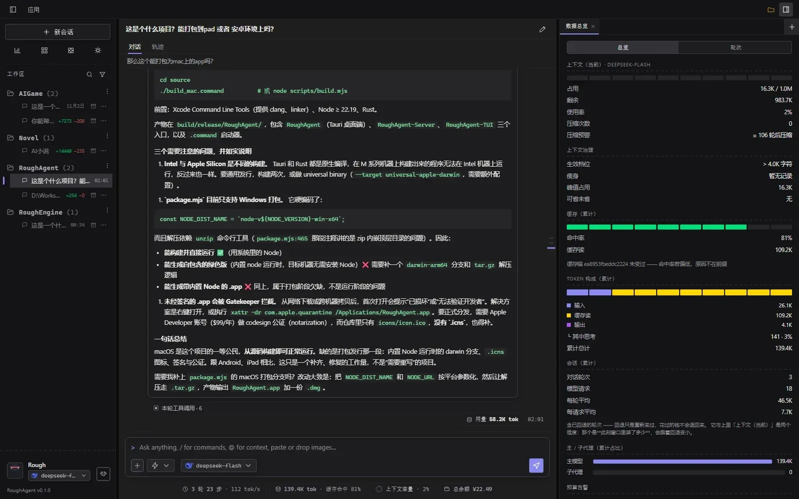
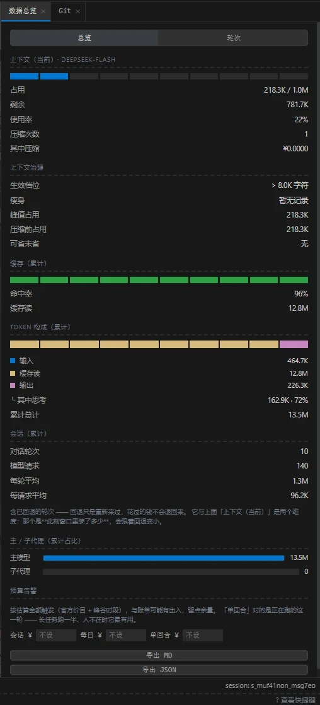
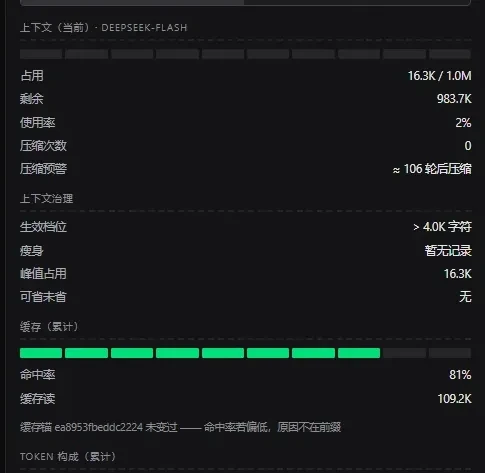
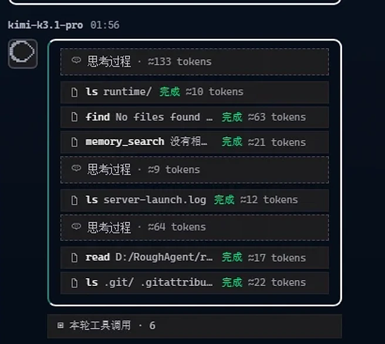
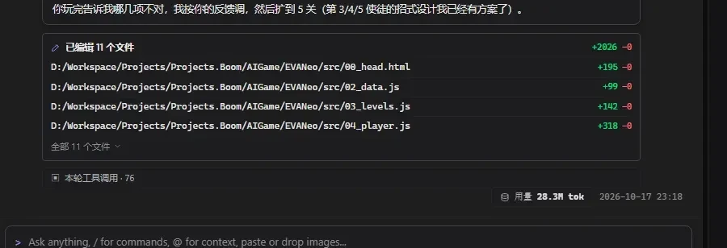
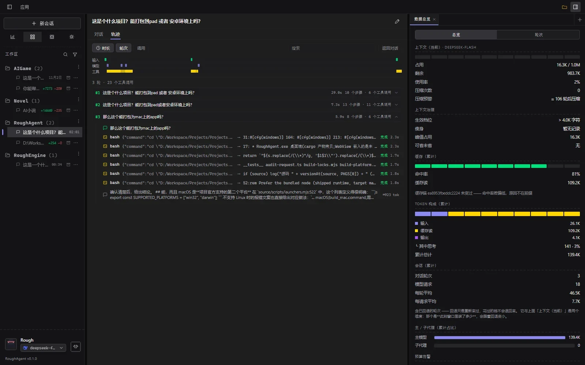
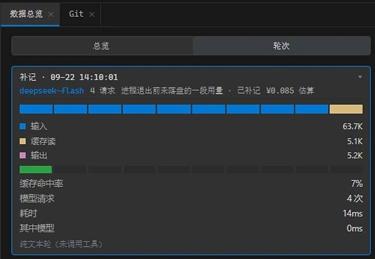
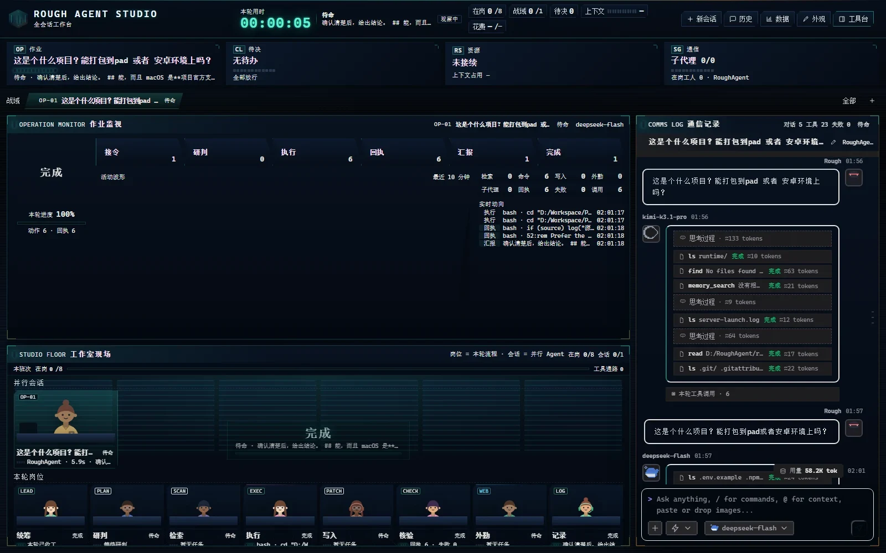

上周让它改一个老项目的构建脚本。我去倒了杯水，回来一看，11 个文件被改了，底下多了一行「用量 28.3M tok」。

它干得不错。可我其实不知道这三分钟里发生了什么：先试了哪条路、错了几次、哪一步最慢、钱花在哪。

这大概是所有 AI 编码工具的常态——你交代一件事，等一会儿，收一个结果。中间那段，只有它自己知道。

模型是黑箱，这件事改不了。但黑箱外面那层壳，是可以开窗的。

RoughAgent 就是我给自己开的那几扇窗。

_左边找活，中间干活，右边验收；三样东西在同一屏里_

---

## 一、内核是 Pi，我做的是外面那层

先把来历交代清楚：RoughAgent 不是从零写的 Agent，它是 Pi 的衍生产品。

Pi 是 earendil-works 开源的 agent 内核（MIT，TypeScript）。模型怎么调、工具怎么执行、会话怎么存、上下文怎么压、那个循环怎么转，归它管；它还给了五种入口——终端界面、单次执行、JSON 事件流、跨进程 RPC、TypeScript SDK，背后是同一套 agent 和 session。

这些我一行内核代码都没改。

我干的事都在它上面：一个 Tauri 桌面壳和三栏工作台；一套账本，按轮、按请求记 token 和钱；一个轨迹页，把会话按轮次摊开；四档审批和「先看计划」；一个插件宿主，管能力域插件。外加皮肤、桌宠、外观这些不太正经的部分。

说白一点：**Pi 负责跑，我负责让你看见它怎么跑。**

这不是一句比喻。账本和轨迹都不是另写的监测工具：内核把每一步、每次用量都发成事件，我在应用层把它们记下来、摊开。

这个分工不只是说法好听。内核换过一次实现，前端 38 项测试一行没改就过了——因为我只用它的 SDK、事件和扩展面。

## 二、一屏装下，不用来回跳

打开就是三栏：左边项目和会话，中间对话，右边面板。

右边不是一排固定按钮。点「+」挑：文件、变更、Git、轨迹、数据总览、浏览器、搜索。挑中就在右边排开，按你打开的顺序；能拖宽，能关掉，关了就真没了，不留一个空槽。

会话多了会乱，所以左边按项目分组，每条会话下面一行小字：这次改了多少行、最后什么时候动过。置顶、归档、改名、分叉、导出都在「更多」里。Ctrl+F 直接搜会话，Ctrl+N 开新的。

分叉说起来轻巧，是因为内核那边本来就是棵树：选一个节点，后面另起一枝就行。

最省事的是鼠标停一下。悬停在一条会话上，会弹出一张卡片：最近几句对话、这次改了哪些文件、属于哪个项目、最后动过的精确时间、多少条消息、现在是在跑还是在等你确认。不用点进去看一眼，再退出来。

对话区也一样。鼠标停在会话流上，右下角会浮出最近一轮的用量条——这轮多少 token、命中率多少、跑了多久。它只在贴着底部时出现，你往上翻历史它就收起，不挡着。

这些都很小。但一天下来，能省掉十几次「点进去看一眼」。

## 三、这一轮的账，就在手边

输入框下面有条矮矮的信息栏，四块：轮了几轮走了几步、吐字多快；用了多少 token、缓存命中多少；上下文还剩几成（一个环）；余额。

四块都能点。点开是明细：这一轮模型花了多久、工具花了多久、首 token 等了多久；token 里多少未命中、多少缓存读、多少输出；上下文里系统提示词、工具定义、对话各占多少；还有本会话、本轮、压缩、子代理各花了多少。

_四个入口，点开各有明细_

它不换行。宽度不够就一级级缩：完整、精简、只剩图标。换行会把输入框顶下去，正打字的人会突然找不到光标——这种小事，用过才知道烦。

右边点开「数据总览」，是同一笔账的展开版：上下文占了多少、压过几次、大概几轮后要压；缓存命中率和存档指纹；token 构成；会话累计的轮次、请求数、每轮平均；主代理和子代理各吃多少；三档预算。

_一个会话的账，全在这七个区块里_

关键是这些数字和账单同源。不是另开一个定时器去采样，而是在用量更新那一刻记下来的。两边要是不一致——面板显示 800K、账单按 780K 结——虽然都没错，但你谁都不敢信。

所以看花费不用打开账单页，看上下文不用进设置，看某一步干了什么不用翻日志。它们就在你正在干活的那个窗口里。

_「缓存存档未变过」这行注释，能立刻分清是前缀变了还是别的原因_

## 四、每一步都对得上

对话流里不再只有一句「正在思考」。思考一块、工具调用一块、工具返回一块，都能折叠；每块后面挂一个 ≈ 数字和耗时。

那个 ≈ 是按字符估的，不是账。工具那一行能拿到的只有入参，准确数要等模型回来。所以界面上把「大概」和「实测」分开：块上带 ≈，轮末和数据面板才是真的。

_≈ 是按字符估的；准数在本轮末尾和数据面板_

一轮结束，底下落三样东西：改了哪些文件（逐个带增删行数）、调用了几次工具、这一轮用了多少 token、跑了多久。

_文件逐个列增删行数，工具次数和本轮用量跟在后面_

开头那个 28.3M，我第一次看也愣了一下：一轮而已，怎么这么大。后来想明白，这一轮调了 76 次工具，背后就是几十次请求，每次都要把上下文重读一遍。**量级来自重复，不来自模型写了多少字。**

想再细看，切「轨迹」：按轮次摊开，一步一行，带耗时和 token；可以按时长、轮次、调用排序，也能搜思考内容、工具参数和输出。鼠标扫过时间轴会跟着出一条竖线，被截断的标题、失败原因，悬停就能看全。

_哪一步慢、哪一步重、哪一步最贵，扫一眼_

有个细节是特意做的：补记。程序崩了、或者被我直接关掉的时候，最后一段用量可能还没落盘。下次启动它会补上，标明时间、几次请求，以及这是估算。账难看点没事，缺一块才麻烦。

_账可以难看，但不能有缺口_

回退也写在明面上：能还原对话、文件和快照，但花掉的钱不会回来。这句话不好听，可要是不说，你迟早会误会。

预算有三档：本会话、每日、单回合。前两档按累计算，往往几十轮才响；单回合那档是给通宵任务准备的——跑一半、人不在，就靠它。可以只提醒，也能直接停。

## 五、想要什么给什么

功能这块我做成了插件。每个能力域插件自带一组工具，装上就能在会话里用。开关对新建或恢复的会话即时生效，已经在线的那条保持原样——界面会写清楚这一点，免得你重启半天才发现压根没生效。

比如连续写作那个插件。装好之后在会话里敲 `/写书`，它写完一步就自己往下走，不再停下来问「要我继续吗」。

右边那些面板其实也是一个思路：不预装一堆，你需要什么开什么。

外观更彻底。内置 12 套配色：Catppuccin、Solarized、Gruvbox、Nord 这些现成的，再加大几套自己还原的。皮肤是一个目录加一个 `skin.json`——给颜色就换配色，再给形状就换圆角、阴影、字体，再给样式就整套重做。带调色器，改完能存成自己的一份，内置的不会被覆盖。

皮肤包里不能有可执行代码。出现 `js`、`eval`、`import` 这类字段，直接拒绝，不悄悄忽略。这样装一个皮肤，不等于装一段来路不明的程序，卸载也卸得干净。

连「会话长什么样」都能改：显不显示头像、用户消息要不要靠右、要不要消息框、提问要不要置顶、输入框下面那条信息栏要不要留。关掉就真的消失，不留一条空的高度。

> 一屏装下所有信息，不等于把所有信息都摊在脸上。想看的留下，不想看的关掉。

还有个开关性质的：**Studio Mode**。同一套事件，换一种读法——本轮用时、在岗人数、并行会话、待决、作业监视、八个岗位的状态、通信记录，全铺在一屏。它没多任何能力，只是把「谁在做什么、做到哪、花了多少」摆开。多会话的时候抬头看看，就知道有没有东西卡住。它确实吵，所以是个开关。

_顶上是用时和在岗状态，中间作业监视，下面工作室现场，右边通信记录_

_昵称、称号、头像、皮肤、主题都在这页；Studio Mode 一开，这页就锁_

桌宠「丢丢」是可选项。它把 Agent 的状态翻译成狗的动作：待命、思考、跑工具、等你批准、出错、搞定。桌面端是个独立置顶的小窗，能拖着走，也能让它休息。它不是装饰，是把「现在能不能走开」做成一个不用读字的信号。

_待命 / 思考中 / 执行工具 / 等你批准 / 出错了 / 搞定啦_

## 六、不再是盲盒

用了几个月，最大的变化不是我更信任它了，而是我知道什么时候该信它。

看得见之后才敢放手。权限有四档，最松的是工作目录内直接跑，最紧的是每一步都要批准。中间那档「先看计划」会先把打算走哪几步、改哪些文件摊给你看，点过头，这一轮就不再打断。私钥目录、明文存密钥的目录，任何档位都不放行，也没有开关。

说到底，这些东西都不聪明。它们不会让模型答得更好，也不会让它跑得更快。

它们只是把黑箱打开一条缝：这一轮大概花多少，卡住的时候卡在哪，出错之后退到哪。你在把一件事交给它之前，能先判断一下值不值、要不要盯着。

名字也是这个意思：Rough 来自工作室名 RoughStone，不预设结果。

它跑在本机，数据在本地，服务只监听本机。
