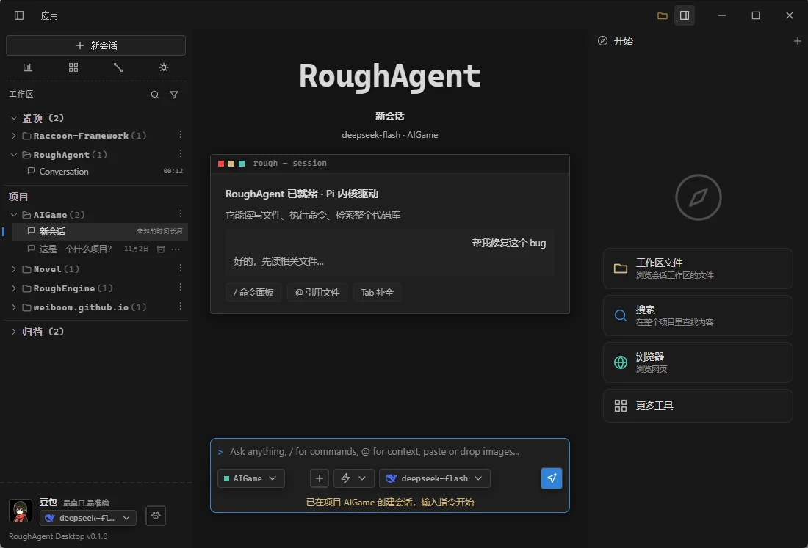
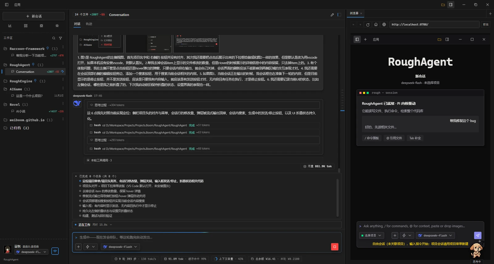
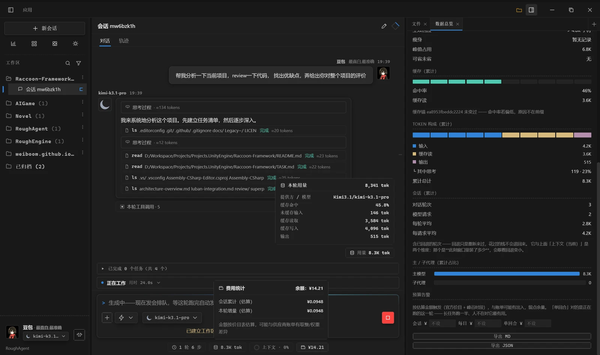
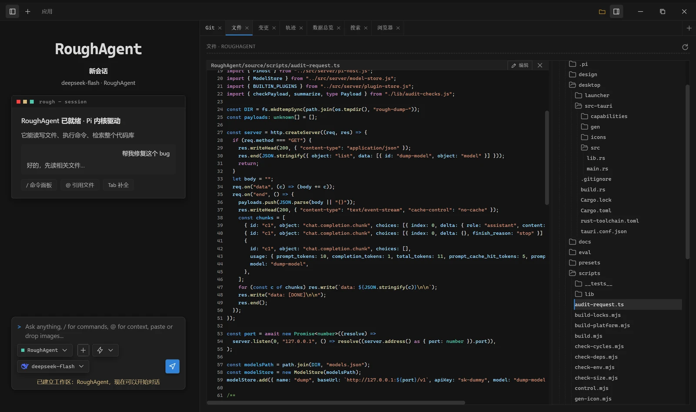
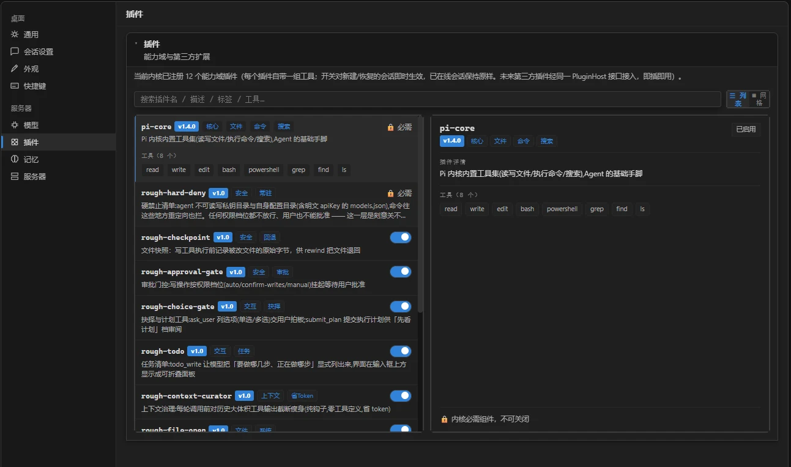
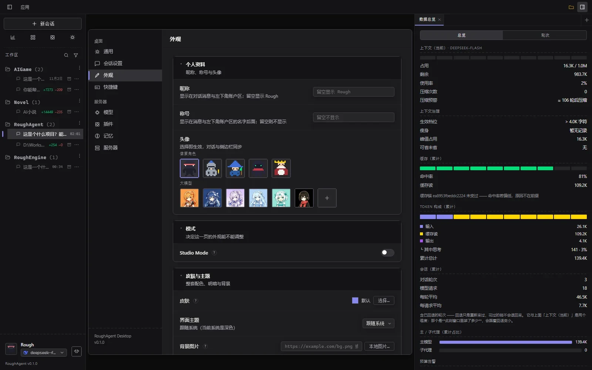
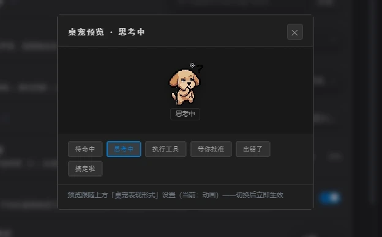
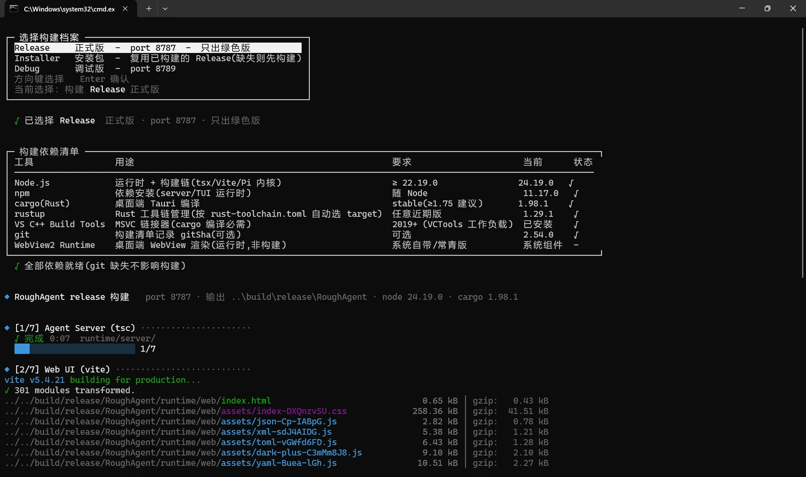

RoughAgent 是一个跑在本机的桌面 Agent，内核是 Pi。界面、账本、审批、插件和外观，都做在内核外面这一层。

主界面固定三块：左边项目和会话，中间对话，右边按需打开的面板。

_左边找活，中间开始，右边看文件、搜代码、开浏览器_

## 一、首页

左边的会话列表按项目分组，置顶和归档分在上下两头。每条会话下面一行小字，写着这次改了多少行、最后什么时候动过。会话多了可以 `Ctrl+F` 搜，`Ctrl+N` 新建。

中间是起始页：一张「RoughAgent 已就绪 · Pi 内核驱动」的卡片，说明它能读写文件、执行命令、检索整个代码库；下面三个入口——`/` 命令面板、`@` 引用文件、`Tab` 补全。

右边「开始」放着常用入口：工作区文件、搜索、浏览器、更多工具。底部输入框能选项目、权限和模型，最下面一条常驻余额。

## 二、任务清单

让它干一个多步骤的活，它先把要做的事列成清单，显示在输入框上方：一共几项、哪项在做、哪项已经完成。面板可以折叠，不占地方。

执行过程也摊在会话里：思考一块、工具调用一块，各带 `≈token` 和耗时；被截断的参数和输出，鼠标停上去能看全。

右边可以同时开一个内置浏览器——它改页面，你刷新就能看，不用切到别的窗口。

_上方是任务清单，中间是每一步的调用与 ≈token，右边是内置浏览器_

## 三、这一轮花了多少

输入框下面一条细栏，常驻四组数：轮次与步数、token 用量、上下文、余额。

点开「本轮用量」，是这一轮的明细：哪个模型、缓存命中多少、未缓存输入多少、缓存读取、缓存写入、输出各多少。点开「费用统计」，是钱：余额、本会话累计、本轮增量。

右侧「数据总览」是一整页：上下文治理（瘦身、峰值占用、可省未省）、缓存命中率与存档指纹、token 构成、会话累计、主 / 子代理占比、三档预算，底部能导出 Markdown 或 JSON。

_一处能看全：上下文、token 构成、本轮用量、费用与余额_

这些数和账单是同源的——不是另开一个定时器采样，面板显示多少，结算就是多少；估算的地方带 `≈`。

## 四、模型：想接哪家接哪家

模型不是写死的。设置里的「模型」页可以加任意多个档案，一个档案就是一组 API 配置：

- **名称**：显示在下拉和状态栏里；
- **Base URL**：任意 OpenAI 兼容地址；填 `mock` 就是内置调试模型，不联网也能跑通流程；
- **API Key**：只存本机。可以勾「存到系统凭据」，交给 Windows DPAPI / macOS 钥匙串 / Linux Secret Service，`models.json` 里只留一个引用；也可以只填环境变量名，明文完全不落盘；
- **模型列表**：一行一个。一个档案能挂多个子模型，比如同一家供应商的 pro 和 flash；
- **上下文窗口**：支持 `1m` / `128k` 这种写法；
- **单次输出上限**：按 API 文档填——它同时是判断「输出有没有被供应商掐断」的基准；
- **图片输入**：多模态模型勾上，纯文本模型取消。

配好之后，对话框底部的模型菜单按供应商分组：内置调试一组、每家供应商一组，组下面是它的子模型；最底下一条「管理模型…」直接跳回设置页。

切换按新建会话生效，正在跑的会话保持原样；换档案等于换账户，余额会跟着刷新。

## 五、AI 改了什么

右侧一排标签：Git、文件、变更、轨迹、数据总览、搜索、浏览器。开哪个由你，关掉就真的没了，不留空位。

- **文件**：左边文件树，点开即预览；也能在预览里直接编辑，改完落盘。
- **变更**：这一轮改了哪些文件，各加减多少行。
- **轨迹**：按轮次摊开，一步一行，带耗时和 token；能按时长、轮次、调用排序，也能搜内容。

_文件、变更、轨迹、数据总览都在右边，不用切窗口_

## 六、能力做成插件

功能不是一块巨大的开关面板，而是 12 个能力域插件，每个自带一组工具：

- **pi-core**：读写文件、执行命令、搜索，Agent 的基础手脚（内核自带，必需）；
- **rough-hard-deny**：私钥目录与密钥配置永不读写，任何档位都不放行（关不掉）；
- **rough-checkpoint**：写文件前留一份原始字节，回退时把文件一起退回；
- **rough-approval-gate**：写操作按权限档位挂起，等你批准；
- **rough-choice-gate**：`ask_user` 把选项交给你，`submit_plan` 先给你看执行计划；
- **rough-todo**：把「要做哪几步、正在做哪步」显式列出来；
- **rough-context-curator**：每轮调用前给历史大输出瘦身，省 token；
- **rough-file-open / rough-memory**：打开生成的文件与网页、跨会话记住偏好；
- **rough-subagent / rough-write-novel / rough-engine-bridge**：子代理、连续写作、引擎接入，按需开启。

开关对新建或恢复的会话即时生效，正在跑的会话保持原样——界面会明确写出来，免得重启半天才发现没生效。第三方插件走同一个 PluginHost 接口，装上就能用。

_每个插件写着版本、标签和自带工具；必需的两项锁着，其余随时开关_

## 七、外观和桌宠

外观是整套换的：12 套内置皮肤，也可以放一个目录加 `skin.json` 自己写（皮肤包里不能有可执行代码）；主题深 / 浅 / 跟随系统，背景图与透明度；气泡透明度、头像、用户消息是否靠右、消息框、提问置顶、底部信息栏，都能单独开关。

另有 Studio Mode：同一套事件换一种读法，把并行会话、岗位状态、通信记录铺满一屏。

_皮肤、主题、背景、资料都在这一页；Studio Mode 打开后这页会锁_

桌宠是可选项：把 Agent 的状态翻译成动作——待命、思考、跑工具、等你批准、出错、搞定。独立置顶小窗，能拖着走，不想看就收起。

_待命 / 思考中 / 执行工具 / 等你批准 / 出错了 / 搞定啦_

## 八、构建

构建脚本打开是个菜单：Release 正式版、Installer 安装包、Debug 调试版。

先检查依赖（Node、npm、cargo、rustup、VS C++ Build Tools、git、WebView2），缺什么直接标出来；然后编译 Agent Server、打包 Web UI，产物在 `build/release/RoughAgent`，绿色版直接能跑，端口 8787；选 Installer 会再套一层安装包。

_选档案 → 查依赖 → 编译 → 出绿色版或安装包_

## 九、接下来

- **账号登录**：现在是本机单用户，之后接账户体系。
- **远程 Mobile 操作**：手机上派活、看进度、批准操作，桌面端继续跑。

现在数据都在本地，服务只监听本机；远程能力会在这个前提下往上加。
