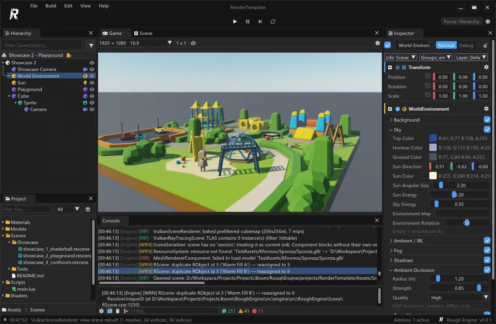
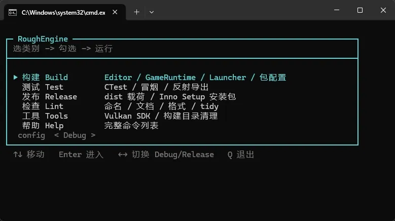
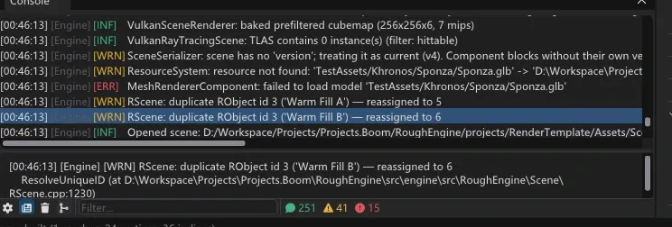

_RenderTemplate 的 showcase_2_playground：左边找对象，中间看画面，右边改参数，下面看日志_

RoughEngine 是一个用 C++ 写的轻量游戏引擎，自带编辑器、渲染器和打包流程。

它最特别的地方不是画质，是接入方式：**AI 可以通过一套操作接口直接建场景、改对象、跑起来、截图检查，人则打开编辑器接着改。** 两边操作的是同一份状态，同一个撤销栈。

先把定位说清楚：这是一个以学习和验证为目的的实验项目，不是生产级引擎。功能在补，缺陷也在。

## 一、引擎里有什么

代码按 14 个功能包切开：核心、外壳、渲染、UI、2D、3D、动画、物理、音频、体素、导航、脚本、导出、MCP。每个包有自己的能力边界和依赖声明，可以整套关掉——比如 2D 配置可以带着动画包、却不带 3D。

摊开看是这么几块：

- **世界与表现**：场景/对象/组件模型、反射与序列化、资源系统；Vulkan 渲染，支持前向光栅、Hybrid Ray Query、路径追踪三条路径。
- **玩法系统**：Jolt 物理（刚体、碰撞、四种约束，可设断裂力）、骨骼与精灵动画、粒子、补间、多轨时间轴、miniaudio 音频（2D/3D、总线、播放头）、Detour 导航、Godot 式输入映射、体素世界（流式、分块 LOD）。
- **工具链**：编辑器、游戏运行时、启动器，以及一个无头的 `mcphost`；打包会输出可直接分发的 dist 载荷。

这些能力大多搭在成熟的三方库上：窗口用 GLFW，编辑器界面用 ImGui（手柄用 ImGuizmo），模型导入用 Assimp，物理用 Jolt，导航用 Recast/Detour，Lua 绑定用 sol2，音频用 miniaudio，数学和日志用 glm 与 spdlog，性能分析用 Tracy。引擎自己写的是把这些东西的决策收在一处的那一层。

渲染这块不算糊弄：GPU 驱动提交、bindless 材质、LightGrid 分簇光照（32 盏本地灯超出 UBO 容量也能跑）、TAAU、天空/空气透视/IBL 共用一份大气实现、光追阴影、Shader 热重载。路径追踪是附加路径——没有光追能力的老显卡，照样能跑完整的前向光栅。

## 二、AI 能全面接进来

不是"留了个聊天框"，是把引擎的操作面整个打开。

引擎侧有 146 个 op，编辑器另有自己的一整套：打开场景、选对象、读组件、改字段、加组件、播放暂停、截图、撤销、导入资源，都有对应的一条。两者走同一条命令通路，作用在同一个场景和同一个撤销栈上。

对外，`mcphost` 是个标准的 MCP 2.0 stdio 服务。AI 连上来先问 `schema.list` 和 `editor.describe`——"你有哪些组件、哪些字段、哪些操作"——然后直接干活，不用读源码，也不用截图猜。

为了让它真的能干活，每个功能都要求配齐三样东西：脚本 API、API 文档、一份教 AI 怎么用的 SKILL。项目里现在有 36 份 SKILL，读一份就知道这个系统怎么调，而不是去逆推十万行代码。

这也是它跟一般引擎最不一样的地方：编辑器里的操作，基本都有等价的一条 op；反过来，AI 做的事，人打开编辑器就能看见、能改、能撤销。

## 三、Lua 和 C# 两套脚本

脚本层是可插拔的 `IScriptBackend`，编译期二选一。

**Lua 是主力。** Lua 5.4 + sol2，玩法逻辑、组件脚本、引擎 API 都走它。能力覆盖得比较全：物理、音频、动画、粒子、补间、时间轴、导航、体素、UI 都有对应绑定。编辑器里能改的，Lua 也能改；AI 通过 op 动的，是同一份数据。

**C# 是实验后端。** 它能编译、能跑，但只暴露了很小一层接口（日志、组件、字段、生成/销毁、按键），没有 Lua 那套完整绑定，也没有跨平台承诺——开启条件是 `ROUGH_ENGINE_SCRIPTING_DOTNET=ON`，只在 Windows 上，且与 Lua 互斥。

说白了：Lua 现在能用，C# 现在只是把位置留出来了。

## 四、编辑器：AI 干活，人接手

编辑器的样子参考的是 Unity：层级在左、场景居中、Inspector 在右、Project 与 Console 在底。玩法侧的习惯更像 Godot：碰撞层、锚点偏移这类配置写在对象自己身上，不搞一张全局表——对人是省事，对 AI 是少一次跳转。

界面是统一的暗色主题配一套像素图标。往深了还有 Animation、Timeline、Profiler、Navigation、Physics、Voxel、Input Map、Scene Settings、Icon Browser 这些工具窗口。

对"接手"这件事有用的几个细节：

- Inspector 里的每个字段都能改，且改完立刻反映到场景；
- 支持多选、Inspector 锁定（切对象时不跟着跳）、材质面板；
- 渲染调试开关收在一张表里，编辑器、op、Lua 读的是同一份；
- 所有编辑进同一个撤销栈——AI 改的和你改的，一起撤。

## 五、一键构建，一条命令出包

构建只有一个入口：双击 `build.bat`。

_构建 / 测试 / 发布 / 检查 / 工具 / 帮助，方向键选，回车跑_

菜单里六类：构建（编辑器、运行时、启动器、包配置）、测试（CTest、冒烟、反射导出）、发布（dist 载荷、Inno Setup 安装包）、检查（命名、文档、格式、clang-tidy）、工具（Vulkan SDK、清构建目录）、帮助。

带参数跑就不弹菜单，脚本和 AI 可以直接调用，比如 `build.bat normal release`。发布那条会出一个干净的 dist 目录，再加一层安装包，拷走就能跑。

平台方面：CMake 里 Windows / macOS / Linux 三条分支都留着，渲染只走 Vulkan、不绑 DirectX；目前稳定验证、能一键出包的是 Windows。

## 六、它还是个实验项目

先把话说在前面：**它能跑、能出图、能打包，但还不能拿来做正经游戏。**

项目里有一份 `STATUS.md` 逐条列着未完成项和开放缺陷，挑几条最要紧的：

- **2D/UI 没做过端到端验证**：系统是有的，但没有一个真玩的游戏（标题 → HUD → 暂停 → 结束）在导出运行时跑通过。
- **资产管线还得手工**：带 Draco 压缩或 WebP 贴图的 glTF，现在要自己转一道。
- **渲染没收完**：光追反射和面剔除还是 PARTIAL，体素和实例化几何不进 TLAS，厂商超分和 Gaussian splat 延后，TrueHDR 卡着。
- **验证有洞**：ASan/TSan、跨 GPU 的 golden、长时间反复启停，都还没常规化。
- **编辑器还有硬伤**：TileMap 只有字段和「清空」，没有画笔。
- **欠账**：一百多处历史命名债，`clang-tidy` 还没进默认门禁；动态包加载没有，现在是静态包。

打开示例场景，控制台就是这样：

_251 条消息，41 个警告，15 个错误——这是一次普通打开_

重复的对象 ID、找不到的 Sponza 资源、加载失败的模型，都还在这里。示例场景本身也没调好：会议室那两个顶灯的坐标在吊顶上面（2.55 对 2.48），光基本被挡住了。

这就是"实验项目"的意思：不是"快好了"，是"主路通了，边上全是活"。

## 最后

它现在的价值不在"能用"，在"能看"：十万行代码、十四个功能包，从渲染、物理、动画到打包流程都摊在同一个工程里，AI 和人读的是同一份东西，改的也是同一份东西。

适合拿来读引擎怎么写、试 AI 开发游戏的流程；不适合拿它上线做项目——至少现在还不适合。

项目目前没有开源，代码在本地。名字里的 Rough 来自工作室名 RoughStone，意思是不预设结果。
